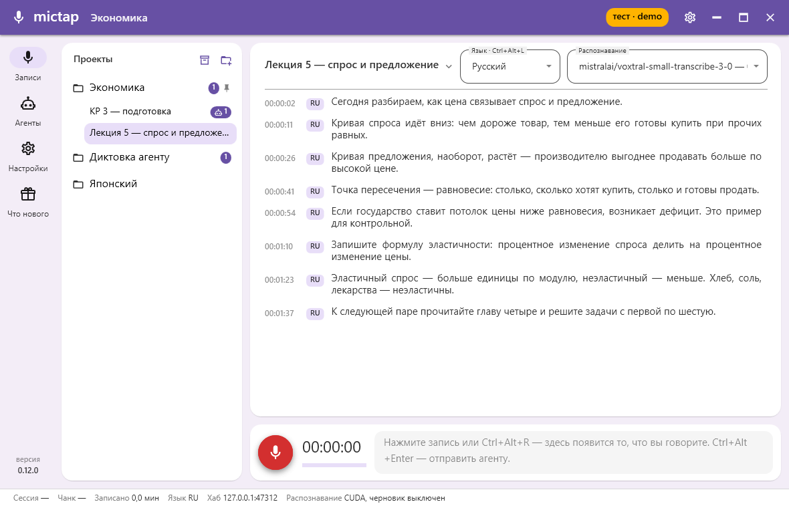
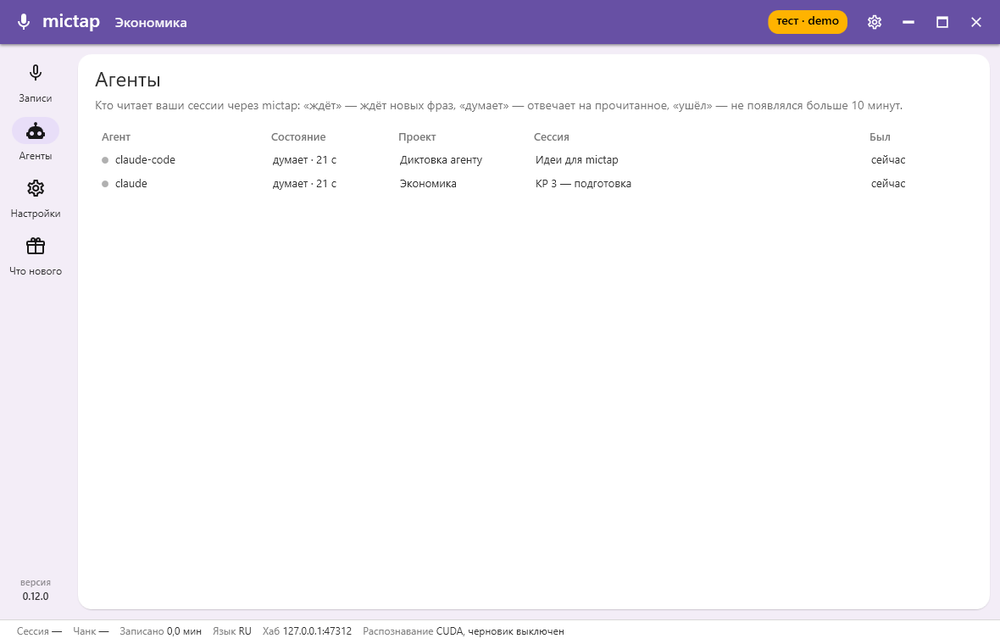
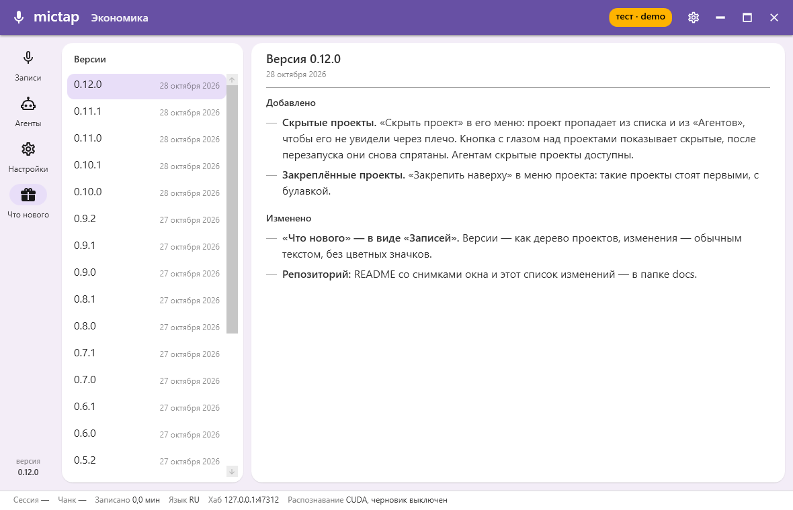

# mictap

Windows-приложение: непрерывно пишет микрофон на диск кусками (WAV, 16 кГц / моно / 16 бит) с защитой от потерь
и тут же распознаёт речь по фразам — на видеокарте (Whisper large-v3-turbo) или, для выбранных проектов, облаком
Router AI. ИИ-агенты читают сказанное через хаб и консольную команду `mictap`.



| Агенты | Что нового |
|---|---|
|  |  |

Снимки — из демонстрационного профиля (`--profile`, плашка «тест» в заголовке) с выдуманными проектами.
Что менялось по версиям — [CHANGELOG.md](CHANGELOG.md).

## Сборка и запуск

Нужны Windows 10/11 и .NET 10 SDK. Для распознавания на видеокарте — NVIDIA с драйвером 580+ и
CUDA Toolkit 13 (достаточно компонентов CUDA Runtime). Без них распознавание работает на CPU:
окно показывает «CPU» красным, живой текст запаздывает на 20–30 с.

```
dotnet build MicTap.slnx
dotnet test MicTap.slnx
dotnet run --project src/MicTap.App
```

Для каждодневной работы — установить и запускать ярлыком «mictap» с рабочего стола или из «Пуска»:

```
powershell -ExecutionPolicy Bypass -File tools\install-app.ps1    # mictap в %LOCALAPPDATA%\mictap\app, ярлыки
```

После обновления кода — закрыть mictap (значок в трее → «Выход») и запустить скрипт снова.

Иконки (`src/MicTap.App/Assets/*.svg`, `*.ico`) генерирует `tools/make-icons.ps1`.

## Как пользоваться

Окно — как в чате: слева дерево проектов и сессий, в центре текст сессии, внизу панель записи.
Окно разворачивается и тянется за края, ширину дерева меняет граница между панелями.

1. Слева «Проекты» — например, по предмету; проект раскрывается в свои сессии, свежие сверху. Под мышью
   папка проекта становится стрелкой — свернуть или развернуть сессии, а справа появляется «+» — новая сессия.
   Значок над деревом создаёт проект. Правый клик по проекту — «Новая сессия», «Настройки проекта» и «Удалить
   проект» (вместе с сессиями, в архив, после подтверждения; во время записи недоступно). Настройки: языки
   (первый — по умолчанию, Ctrl+Alt+L идёт по кругу), что делать со звуком (хранить, удалять после
   распознавания или не сохранять) и пауза фразы. При первом запуске есть проект «Общий» (ru, ja, хранить,
   1,2 с). Число в конце строки проекта или сессии — сколько там агентов, красная точка — идёт запись.
2. Щелчок по сессии показывает её текст в центре, имя сессии — над текстом. Щелчок по имени (или правый клик
   по сессии в дереве) — меню: «Переименовать», «Открыть папку», «Распознать заново» (звук ещё раз через VAD и
   Whisper с языками по меткам, прежний текст остаётся в `transcript.<время>.bak`; недоступно, если звука нет),
   «Сравнить модели…» (звук сессии распознают выбранные модели на одних и тех же фразах; результат — в
   `compare\<время>\comparison.md` рядом, по файлу на модель и `summary.json` с рублями; основной текст не меняется),
   «Перенести в проект» и «Удалить» (в архив, после подтверждения; записываемую — после остановки). Кнопка «Архив»
   над проектами показывает удалённое: «Восстановить» возвращает проект или сессию на место, «Удалить насовсем» —
   после второго подтверждения. Через 30 дней (в «Настройках»: 7, 30, 90 дней, год или всегда) архив удаляет их сам.
   Перенести можно и мышью: перетащить сессию на другой проект.
3. Новая сессия получает имя по времени начала записи (`yyyy-MM-dd_HH-mm-ss`); своё имя задаётся в том же
   меню до, во время (применится к папке после остановки) или после записи. Выбрана существующая сессия —
   запись допишется в неё: номера кусков, `seq` и время продолжаются.
4. Внизу — панель записи, как поле ввода в чате. Красная кнопка — старт, во время записи на её месте стоп.
   Справа стрелка «Отправить агенту сейчас» (Ctrl+Alt+Enter): мысль закончена — фраза уходит в текст, не дожидаясь
   паузы, и агент получает всё непрочитанное сразу (подробнее — в разделе «Агенты»).
   Серым в панели — черновик: то, что вы говорите сейчас и чего ещё нет в тексте; обновляется каждые 3 с, «(тишина)» —
   речи нет, Whisper не вызывается. В «Настройках» черновик можно обновлять раз в 10 с или выключить — это главная
   постоянная нагрузка на видеокарту, готовые фразы от этого не меняются (ползунок: 0 — выключен, до 30 с). Таймер показывает время сессии, как у фраз.
   Справа над текстом сессии — «Язык» и «Распознавание» проекта. Язык: смена во время записи ставит метку, речь после
   неё распознаётся на новом языке; короткий сигнал (выше — японский), язык виден в трее и в строке статуса.
5. Фраза заканчивается, когда вы молчите дольше паузы проекта (по умолчанию 1,2 с — для лекций; для
   разговора, где думают перед ответом, 2–3 с); тогда она уходит из панели в текст чёрным, с временем и языком,
   и в `transcript.jsonl`. Длинная речь режется до 30 с по паузе между словами. Фразы, которые Whisper
   выдумывает из шума («Продолжение следует…», «Субтитры сделал…», «Спасибо за просмотр»), в текст не попадают,
   только в журнал. Щёлкнуть по фразе, исправить, перейти к другому полю — правка сохранена. Над текстом —
   агенты сессии: «ждёт», «думает · N с», «ушёл».
6. Строка статуса внизу окна: «Записано», «Распознавание» — где оно реально работает (CUDA или CPU; при сбое
   «сбой» и перезапуск сам через 1, 2, 4 … 30 с, фразы ждут в очереди), «Хаб», «Чанк», «Язык».
7. Шестерёнка в заголовке — «Настройки»: папка проектов (по умолчанию `%LOCALAPPDATA%\mictap\projects\`),
   микрофон, хоткеи, адрес хаба и где всё это меняется.
8. «—» в заголовке сворачивает окно в трей, клик по значку в трее возвращает его.
   Закрытие во время записи — с подтверждением.

Хоткеи работают и из трея: Ctrl+Alt+L — следующий язык, Ctrl+Alt+R — старт / стоп записи, Ctrl+Alt+Enter —
отправить агенту сейчас (два коротких сигнала). Меняются в
`settings.json` (`hotkeys`); занятое или неверное сочетание — сообщение в окне.

При первом запуске модели (Whisper 1,6 ГБ и VAD 0,9 МБ) скачиваются в `%APPDATA%\mictap\models\` — прогресс
в окне. Записывать можно сразу: фразы ждут в очереди, пока модель не загрузится.

## Router AI: фразы в облаке

Слева — боковое меню: «Записи» (проекты, сессии, запись), «Агенты» (кто из агентов ждёт, думает или ушёл — по всем
сессиям), «Настройки» и «Что нового» (изменения по версиям, из CHANGELOG.md). В меню проекта (правая кнопка мыши)
есть «Закрепить наверху» и «Скрыть проект»: скрытый проект не виден в списке и в «Агентах», пока не нажата кнопка с
глазом над проектами; после перезапуска он снова спрятан.

Проекту можно поручить распознавание облаку Router AI (routerai.ru, платно, по секундам звука). Переключается прямо в
окне: над текстом сессии поле «Распознавание» — «Видеокарта · Whisper» или модель Router AI с ценой за минуту речи
(список берётся из открытого каталога Router AI при запуске, по цене; «по токенам» — модели с оплатой за токены).
В поле можно печатать — список фильтруется по имени модели («eleven», «gpt»). Сердечко слева от модели — «понравилась»
в этом проекте: такие модели стоят в начале списка и отмечены по умолчанию в «Сравнить модели»; у каждого проекта свои
(для японского нравятся одни, для лекций другие). Выбор сохраняется в проекте и действует со следующей фразы, в том
числе во время записи и для фраз, что ждут в очереди: если модель не отвечает, достаточно выбрать другую. То же есть в «Настройках проекта». Ключ создаётся в
кабинете Router AI и вставляется в «Настройках» mictap → «Router AI» → «Сохранить»; он хранится в диспетчере учётных
данных Windows, не в файлах. Готовые фразы такого проекта уходят в облако, черновик в панели записи распознаётся на
этом компьютере. Нет сети или ключа — фразы ждут в очереди и отправляются, как только получится; в строке статуса
«Фразы Router AI · сбой» и причина. Сколько потрачено: в строке статуса во время записи — рубли текущей модели в
сессии; кнопка с графиком рядом с именем сессии — расход по каждой модели (рубли, минуты, фразы, слова, токены); в подсказке
проекта в дереве — рубли и минуты звука за все его сессии (по ответам Router AI, файл `cloud.json` сессии).
«Распознать заново» работает локально.

## Агенты: команда mictap

Пока mictap запущен, внутри него работает хаб на `127.0.0.1:47310` (порт — `hubPort` в `settings.json`;
занят — в строке статуса «Хаб выключен», запись работает). Агенты читают текст командой `mictap`:

```
powershell -ExecutionPolicy Bypass -File tools\install-cli.ps1    # один раз: mictap.exe в %LOCALAPPDATA%\mictap\bin и в PATH
mictap wait --min-words 20                # ждёт 20 слов в активной записи, печатает JSON и выходит
mictap wait --project Японский --session "Пара 1" --agent claude --max-wait 60
mictap status | mictap projects | mictap sessions --project Японский | mictap tail --session "Пара 1" --seq 10
```

`wait` — петля: вызвать, обработать сегменты, вызвать снова; следующий вызов продолжает с курсора
(`agents\<agent>.json`), `--from-start` читает сессию сначала. Ответ — одна строка:
`{"project":…,"session":…,"reason":"min_words","from_seq":1,"to_seq":4,"lang_now":"ru","segments":[{"seq":1,"start":3.2,"end":7.9,"lang":"ru","text":"…"}]}`.
`reason`: `first_event`, `min_words`, `max_wait`, `session_stopped` — запись остановлена, и её последние фразы уже
распознаны и лежат в `segments`; `force_push` — пользователь нажал «Отправить агенту сейчас»: мысль закончена, он ждёт
ответа, а последняя фраза уже в `segments`. Пока последние фразы остановленной записи распознаются, `wait` без
`--session` всё ещё находит эту запись. Нажатие, пока никто не ждёт,
вернёт следующий `wait` сразу. `--project` без `--session` — запись этого проекта.
Новый `wait` того же `--agent` на той же сессии вытесняет старый, ещё висящий: тот выходит с кодом 5 и курсор не
двигает. Если агент вызывает `mictap` через инструмент с таймаутом, `--max-wait` должен быть заметно меньше
таймаута: через Claude Desktop (бросает вызов через 60 с) — не больше 45.
Коды выхода: 2 — нет проекта или сессии (или ничего не записывается), 3 — mictap не запущен, 4 — неверные
аргументы, 5 — этот `wait` вытеснен новым. Над текстом сессии видно её агентов: «ждёт», «думает · N с», «ушёл»
(больше 10 минут).
PATH меняется для новых окон терминала: после установки открыть терминал заново.

## Данные на диске

- Настройки: `%APPDATA%\mictap\settings.json` — `rootFolder` (папка проектов), `deviceName`, `chunkSeconds`
  (по умолчанию 60), `hotkeys` (`toggleLanguage`, `toggleRecording`, `forcePush`), `hubPort` (47310),
  `liveDraftSeconds` — как часто обновляется черновик: 3 (по умолчанию), 10 или 0 — выключен; `archiveDays` — сколько
  дней архив хранит удалённое (30; 0 — всегда).
- Архив: `<rootFolder>\.archive\` (скрытая) — удалённые проекты и сессии целиком, у каждого `archive.json`
  `{kind, name, originalFolder, projectName, projectFolder, deletedAt}`.
- Журнал: `%APPDATA%\mictap\logs\`.
- Модели: `%APPDATA%\mictap\models\ggml-large-v3-turbo.bin` и `ggml-silero-v6.2.0.bin` (VAD); SHA-256
  проверяется после скачивания.
- Проект: `<rootFolder>\<проект>\project.json` —
  `{"schemaVersion":3,"name":"Японский","languages":["ja","ru"],"audioRetention":"deleteAfterTranscript","phrasePauseSeconds":3,"engine":"routerAi","cloudModel":"openai/whisper-large-v3"}`,
  `audioRetention`: `keep` | `deleteAfterTranscript` | `none`; `phrasePauseSeconds` — молчание, после которого
  фраза закончена, 0,5–10 с, по умолчанию 1,2 (файл `schemaVersion` 1 читается с 1,2); `engine`: `local` |
  `routerAi`, `cloudModel` — модель Router AI (файлы версий 1–2 читаются как `local`).
- Ключ Router AI: диспетчер учётных данных Windows → «Учётные данные Windows» → `mictap/routerai`.
- Сессия: `<rootFolder>\<проект>\<сессия>\`:
  - `audio\000.wav`, `001.wav`, … — чанки по `chunkSeconds` (хранение; распознавание идёт по фразам);
    при `deleteAfterTranscript` чанк удаляется, когда вся его речь записана в текст, при `none` не пишется;
  - `meta.json` — `schemaVersion` (2), `starts` [{`time`, `offset`, `duration`}] — каждая запись в сессию,
    `device`, `format`, `chunkSeconds`, `appVersion`, `languageMarks` [{`at`, `lang`}] — первая метка в 0 с;
  - `agents\<agent>.json` — `{cursor, lastSeen, policy}`: последний выданный `seq`, когда агент был,
    его последние `--min-words` / `--max-wait`; `notes\` — для заметок агентов, mictap туда не пишет;
  - `cloud.json` — только у сессий с Router AI: `{"schemaVersion":2,"requests":12,"seconds":95.4,"rubles":1.27,"models":{"x-ai/grok-stt-1.0":{"requests":12,"seconds":95.4,"rubles":1.27,"inputTokens":0,"outputTokens":0,"words":310}}}`
    — сколько фраз ушло в облако, их секунды звука и стоимость в рублях по ответам Router AI, итог и по моделям;
  - `transcript.jsonl` — строка на фразу:
    `{"schemaVersion":2,"seq":1,"start":3.2,"end":7.9,"lang":"ru","text":"…","edited":false}`,
    `start`/`end` — секунды от начала сессии, `edited` — текст исправлен в окне.

## Надёжность

- Поток захвата только копирует звук в очередь; диск пишет отдельный поток. В очереди помещается 60 с звука:
  медленный диск звук не теряет, а если стоит дольше — запись останавливается с причиной «диск не успевает».
- Записанное сбрасывается на диск раз в секунду; у открытого чанка нулевые размеры в WAV-заголовке.
- Пока идёт запись, Windows не уходит в сон (экран при этом гаснет как обычно).
- Следующий чанк открывается до закрытия предыдущего, граница режется по байту — без дыр.
- При старте незакрытые чанки последней сессии получают размеры по фактической длине файла.
- Ошибка микрофона или 5 с без данных от драйвера (устройство отключено или система спала) останавливают
  запись; причина — в окне, в журнале и уведомлении из трея. Тишина в аудитории запись не останавливает.
- Распознавание работает в своих потоках и запись не тормозит. Упавший Whisper перезапускается сам,
  несделанные фразы ждут в очереди; причина — в окне справа и в журнале.

## Перед парой

- Ноутбук — от сети, или на батарее в настройках питания «Переводить в спящий режим» → «Никогда».
- Действие при закрытии крышки — «Действие не требуется».

## Проверка с микрофоном

1. В «Настройках» выбрать папку и микрофон, нажать запись, говорить 10–20 с, остановить. В папке сессии `audio\000.wav`
   проигрывается, в `meta.json` — устройство и формат. Для проверки ротации поставить `"chunkSeconds": 5`
   в `settings.json` до запуска.
2. Во время записи выдернуть USB-микрофон (или отключить его в «Параметры → Система → Звук»). Запись
   останавливается, в окне красная плашка с причиной, записанное проигрывается.
3. Во время записи завершить процесс: `taskkill /f /im MicTap.App.exe`. Запустить снова — в окне сообщение,
   что заголовки восстановлены; последний чанк проигрывается.
4. В строке статуса «Распознавание: CUDA». Начать запись и сказать фразу — в панели записи её слова
   появляются серым в течение 5 с. Замолчать дольше паузы проекта — фраза уходит из панели в текст и в
   `transcript.jsonl`; исправить слово, щёлкнуть в другое поле — строка в `transcript.jsonl` изменилась,
   `edited` стал `true`.
5. Фраза на русском, Ctrl+Alt+L (сигнал, в трее и в строке статуса JA), фраза на японском, стоп — в
   `transcript.jsonl` две строки с `"lang":"ru"` и `"lang":"ja"`, в `meta.json` — метка с временем нажатия.
6. 30 с молчания — ни одной новой строки, в панели записи — «(тишина)».
7. Сборка Debug: в меню трея «Имитировать сбой распознавания» — в статусе «сбой», через секунду снова «CUDA»;
   фраза, сказанная в это время, всё равно появляется в тексте.
8. Значок «Новый проект» над деревом: «Японский», языки `ja, ru`, звук «Удалять после распознавания». Запись,
   пара фраз, стоп — в `<проект>\<сессия>\audio\` пусто, `transcript.jsonl` на месте; в заголовке окна
   «Японский», над текстом — имя сессии.
9. Выбрать ту же сессию и записать ещё — в `transcript.jsonl` `seq` продолжается, в `meta.json` второй старт.
10. В статусе «Хаб: 127.0.0.1:47310». Запись идёт; в новом окне Git Bash `mictap wait --min-words 20` — пока
    агент ждёт, над текстом «claude · ждёт», у сессии в дереве 1; после 20 сказанных слов печатается JSON,
    команда выходит, над текстом «claude · думает · N с».
11. Проект с паузой 3 с, запись, `mictap wait --min-words 100` в Git Bash. Сказать фразу и сразу нажать стрелку
    «Отправить агенту сейчас» (или Ctrl+Alt+Enter) — два сигнала, фраза уходит в текст раньше паузы, `wait`
    печатает её с `"reason":"force_push"` и выходит. Нажать ещё раз, пока никто не ждёт, и снова вызвать `wait` —
    возвращается сразу с `force_push`.
